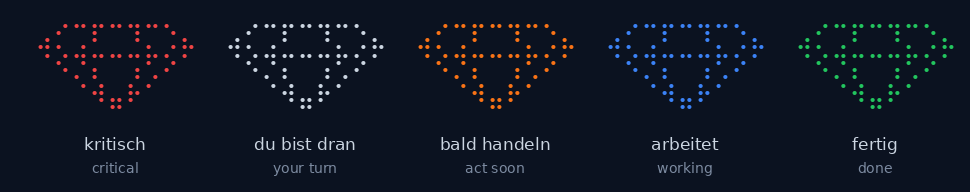
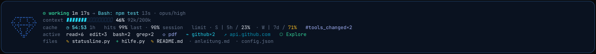
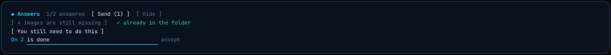
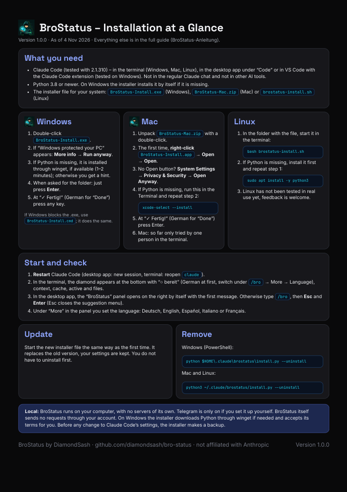
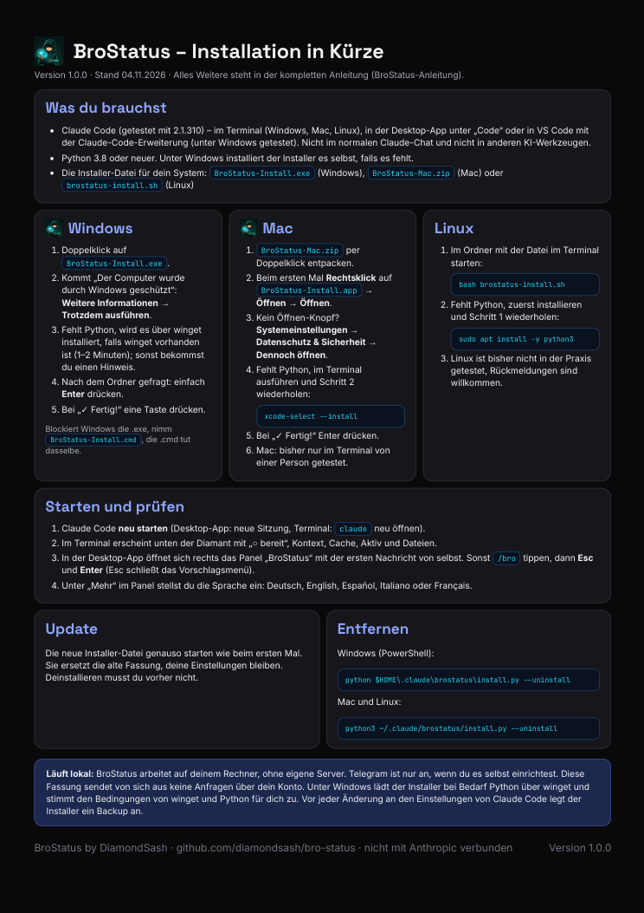

# BroStatus

BroStatus is a mod for Claude Code, meaning an add-on that hooks into Claude Code. A diamond shows you by its color whether Claude is working, waiting for you or done. Next to it you see context, limits, prompt cache, tools and files. There are also answer buttons, sounds and a `/bro` panel. *(The prompt cache is the already-processed start of your conversation that Anthropic stores briefly. During longer pauses it expires and is computed again.)*

BroStatus runs locally and free of charge on your computer (exceptions are listed under “Privacy”). License: MIT with Commons Clause, not open source in the OSI sense. **Deutsch:** [README.md](README.md)

> **About this edition:** BroStatus sends nothing on its own through your Claude account here. Keep cache warm, Auto-Compact, Wrap-up and model switch are not included in this edition because they send requests automatically through the account, and it has not been clarified whether that fits Anthropic's terms of use for subscriptions. I have asked Anthropic (see “Planned”). Use at your own risk, without warranty.

| Color | Meaning |
| --- | --- |
| red | critical (error, context at 85 % or more, cache about to expire) |
| gray/silver | your turn, Claude is waiting for you |
| orange | act soon (context at 50 % or more, cache expires soon) |
| blue | Claude is working (also “working in the background” while something is still running) |
| green | done, all good |

## Where it runs

Only in **Claude Code**:
- in the terminal (`claude`) on Windows, Mac and Linux (for the test status see “Tested”)
- in the Claude desktop app under “Code”
- in editors such as VS Code with the Claude Code extension (tested on Windows on 29 Oct 2026: panel, status and currency)

It does not run in the regular Claude chat or in other AI tools (for example Cursor, Codex, Gemini).

**Version:** Tested with Claude Code 2.1.310. I have not determined a minimum version and have not checked older ones. The mod uses Claude Code's mod interface, and that can change. The status line and the hook do not depend on the mod and keep running without it. If something stops working after an update, please report it as an issue with your Claude Code version (`claude --version`).

You need a Claude Code version with mod support and Python 3.8 or newer (on Windows the installer installs Python itself if it is missing).

## Install

Download the file for your system from the [`Installer`](Installer) folder:

| System | File |
| --- | --- |
| Windows | `Installer/Windows/BroStatus-Install.exe` (or `.cmd`), double-click |
| Mac | unpack `Installer/Mac/BroStatus-Mac.zip`, open `BroStatus-Install.app` (unsigned, macOS warns, see below) |
| Linux (**untested**, the hands-on test was canceled) | `Installer/Linux/brostatus-install.sh`, then `bash brostatus-install.sh` |

Then restart Claude Code (desktop app: new session). To open the panel type `/bro`; if the menu suggests something else (for example a skill), press Esc first and then Enter. The installers are unsigned, so your system may warn you. On macOS the way to open the app anyway depends on the version: right-click → Open, or System Settings → Privacy & Security → “Open Anyway”.

The panel and the status line start in German. Switch the language under `/bro` → More → Language.

**Checksums:** `Installer/SHA256SUMS.txt` lists the SHA-256 checksums of the installers. On Windows compare them with `Get-FileHash <file> -Algorithm SHA256`, on Mac and Linux with `shasum -a 256 <file>`. The checksums are in the same repo: they help against broken downloads, not against a modified repo. If you would rather not run a ready-made file, use `python install.py` from the `brostatus` folder; the source code is in the repo.

**What the installer changes:** It changes these entries in your `settings.json`: `statusLine`, `hooks` (for BroStatus's events) and `env.CLAUDE_CODE_PLUGIN_DIRS`. An existing status line is replaced; it stays in the backup. It also copies the files to `~/.claude/brostatus` and gives the folder an icon. The Windows script starts PowerShell with `-ExecutionPolicy Bypass`, for this one run only, so that it works without changing your system settings. It unpacks to `%TEMP%\brostatus-setup`. The first characters of the command Claude is running also appear in the panel, the status line and the window title; if you share your screen, they can become visible.

**Backup and uninstall:** Before every change the installer copies your Claude Code settings to `settings.json.bak-<date>` next to the `settings.json` in the Claude folder. To remove BroStatus there is one command per system, and it makes a backup again:

| System | Command |
| --- | --- |
| Mac and Linux (Terminal) | `python3 ~/.claude/brostatus/install.py --uninstall` |
| Windows (PowerShell) | `python $HOME\.claude\brostatus\install.py --uninstall` |

If PowerShell does not find `python`, try `py`; if you chose your own folder, use that path instead. When you uninstall, the `brostatus` folder stays, with your `config.json` (it holds your Telegram token, if you set one up). Delete it by hand when you no longer need it. The `state/` subfolder holds local state data: full file paths, the first characters of commands, search terms and task descriptions, host names from calls, the names of skills, MCP servers and helper agents used (with a counter) and the last waiting message. If a command line contains a secret, a piece of it can end up there and in the window title (switch the window title off with `"window_title": false` in `config.json`). While BroStatus is installed, it deletes files in `state/` that are older than 7 days when a session starts.

## What it looks like

The `/bro` panel shows the status at the top like the status line, below it three circles (time left in the cache, hit rate of the last request, hit rate of the session) and switches for sounds. With the `◆ ▸` button you collapse it so that only the status and the circles remain. Under “More” there are sounds (with volume), currency, language and an explanation for each.

## Examples

**Cache:** You are working on something, get distracted and forget the chat. The cache, the temporary store for the part of the conversation Claude has already read, expires after a pause. BroStatus shows you the time left and the state (warm or cold), so you see whether your next message will be cheap or whether Claude has to read everything again. If you send a message yourself in time, it stays warm. If it is cold, you do not lose your conversation; the next message just costs more. With a subscription that counts against your usage limit instead of costing money.

**Compact:** When you work for a long, focused stretch, you lose track of the context. The fuller it gets, the more accuracy and recall degrade (often called “context rot”). The context bar shows how full it is and turns orange and red in good time. So you can save the state yourself and summarize the history with `/compact` before Claude Code does it on its own at some point. What is in your files stays. What was only in the chat is afterwards only in the shorter summary.

**Sounds:** You are doing something else while Claude works. When Claude asks for an approval or shows a choice, BroStatus plays a warning sound in the desktop app, and you can come back and respond. When Claude is done after a longer run, a quiet sound plays. You set both under “More” or switch them off. In the terminal the terminal bell sounds instead.

**Numbers with ≈:** In the cost row, ≈ means “estimate, not an exact value”. The API figure comes from Claude Code (computed locally from token counts at list price; with a subscription you do not pay it). For the line “next message ≈ … tokens” BroStatus uses the cache-read factor of the model you are using (according to Anthropic's price list, as of 29 Oct 2026: 0.05 for Opus 5.5 and Sonnet 5.5, 0.025 for Fable 5.1 and Mythos 5.1, otherwise 0.1). If BroStatus does not know the model, it uses 0.1. For new models the factor may differ.

## What BroStatus can do

- **Status line** at the bottom of Claude Code: status, context traffic light (bar yellow from 50 %, orange from 70 %, red from 85 %), limits (`· S | 5h / 23%  · W | 7d / 71%`: S = session with 5 hours, W = week with 7 days, the percentage is the share used), prompt cache with time left and hit rate, tools used, skills, MCP servers and changed files.

  
- **Panel `/bro`** (in the desktop app it opens by itself with your first message): status, the three circles (time left in the cache, hit rate of the last request and of the session), limits, costs and switches for sounds, currency and language. The panel itself sends nothing and uses no tokens.
- **Not included (yet):** Keep cache warm, Auto-Compact, Wrap-up and model switch. They send requests automatically through your account; see “Planned”.
- **Currency:** Under “More” you choose dollar, euro, pound or franc. The API value in the cost row is converted with a built-in rate (ECB reference rate of 28 Oct 2026; the date is shown in the panel; your own rate goes in `config.json`). BroStatus does not fetch rates from the internet, and the rate is updated with every new version. It stays an estimate (≈), not an invoice amount.
- **Sounds in the desktop app:** a warning sound when Claude is really waiting for you, and a quiet sound when Claude is done. If you want, the sound repeats every 2 or 5 minutes, at most 3 times, and stops as soon as you react. You set the volume under “More” in four steps (on Windows). You can add your own sounds (see “Own sounds and sound packs” below).
- **Getting your attention:** BroStatus shows Claude's state in the window title, sends a notification in the terminal (depending on the terminal; in the desktop app only the sound plays) and, if you set it up, a Telegram message to your phone (details under “Privacy” and in the guide).
- **Answer buttons:** When Claude asks several questions, you get buttons above the input field instead of typing. Click an item, type the answer, and “Send” sends everything together. For a yes/no question there are the buttons “Yes” and “No”, for named options WAY 1 and WAY 2, and under a report there are the buttons NEXT TASK, SAVE and WHAT IS OPEN?. One click sends right away. These three buttons send “Show me the tasks that can start now.”, “Save now: check, commit, pull request.” and “What is still open for this task?”, and are meant for projects with a task list and Git.

  
- **Five languages:** Deutsch, English, Español, Italiano, Français.

## Planned

- **The omitted features** (keep cache warm, Auto-Compact, Wrap-up, model switch): They will come in a later edition once it is clarified whether they fit Anthropic's terms of use for subscriptions. I have asked Anthropic about it ([anthropics/claude-code#106161](https://github.com/anthropics/claude-code/issues/106161)); an answer is still pending. That is not a promise. A model switch with choice buttons is to follow later for this edition; whether and how it works in the desktop app is still open.

## Security and trust

BroStatus changes settings on your computer and runs code there. You do not have to take my word for it, you can check it:

- **Read the source:** All scripts (`brostatus/`) are plain text. If you would rather not run a ready-made file, use `python install.py` from the `brostatus` folder.
- **Checksums:** `Installer/SHA256SUMS.txt` (how to compare: see “Install”).
- **Virus scanner:** I scanned the four installers (Windows `.exe` and `.cmd`, Mac `.zip`, Linux `.sh`) with Microsoft Defender on the command line on 4 Nov 2026. The checksums of these files are in `Installer/SHA256SUMS.txt`; Defender found nothing. One scanner is not proof. The installers are unsigned, and some scanners flag unsigned programs even for no good reason.
- **My own check:** Before publishing I had the source code and the contents of the installers reviewed for security and privacy with an AI tool (the mod by targeted search, not line by line) and fixed the findings. That is a help, not an independent audit.
- **Independent review wanted:** Do you have a security background? Then please have a look at the code or the installers, for example with your own virus scanners, in a sandbox or by reading the source. You can report a confirmation as a normal issue; please report a security finding privately (see [SECURITY.md](SECURITY.md)). If you like, I will credit you in the [CHANGELOG](CHANGELOG.md). So far nobody has confirmed it independently. Once someone does, it will be stated here.

## Privacy

BroStatus sends no data to me. What Claude Code transmits to Anthropic anyway stays as it is. Beyond that, only the following leaves your computer:
- **Telegram (only if you set it up):** Messages when Claude is done or waiting go to your own bot (through Telegram's servers). They contain the project name and the notice that Claude Code itself shows (up to 80 characters). The first 400 characters of Claude's last answer and the computer name are added only if you switch them on yourself in the configuration (off by default). Bot token and chat ID are stored in BroStatus's configuration file on your computer, in plain text. On Mac and Linux the file is readable only by you; on Windows the installer sets no file permissions of its own. If you use BroStatus for work, Telegram may carry confidential data to a service outside the EU; that is up to you.
- **Requests to Claude:** This edition creates no requests of its own through your Claude account. The buttons under reports (NEXT TASK, SAVE, WHAT IS OPEN?) and the answer buttons send a message into your session only when you click, as if you had typed it; that counts against your tokens and limits.
- **Python download:** The Windows installer downloads Python through `winget` if needed. It accepts the license and source terms of winget and Python for you.

The status line and the panel themselves use no tokens.

## Own sounds and sound packs (Windows)

You can design BroStatus's sounds yourself:

1. Put WAV files into the folder `%USERPROFILE%\.claude\brostatus\toene`.
2. The name says what the sound is for: `warten-<Name>.wav` is the warning sound when Claude is waiting for you, `fertig-<Name>.wav` is the quiet sound when Claude is done. Example: `warten-Bell.wav` and `fertig-Bell.wav` (the prefixes are German).
3. Start a new session. Under “More” → Sounds your sounds appear after the built-in ones, and the first time they are already selected. An update does not delete them.

**Sound packs:** A pack is simply a ZIP with such files that others unpack into the same folder. Have you built a sound set or improved the sounds? Then share it as an issue (template “Share a sound set”) with a link to your pack. Say where the sounds come from and under which license. I link suitable packs here in the README once the license is clear, and I credit you if you wish. The pack itself stays with you, not in this repo.

Please only share sounds you made yourself or that may be used freely. Sounds from films, series or games usually may not be shared (not legal advice). Limits: Windows only, WAV files only. I generated the sounds that come with BroStatus myself with code, not taken from other sources; they are under the same license as the code.

## Repository layout

- `Installer/`: the ready-made installers and the checksums
- `Anleitung/`: the guides as PDF in five languages
- `brostatus/`: the source code (status line, hook, installer script); `bro-status/` inside it is the mod
- `brostatus/README.md`: the technical description for those who want to dig deeper (in German)
- `bilder/`: the pictures on this page

## Guides

In the [`Anleitung`](Anleitung) folder, one subfolder per language: [`EN`](Anleitung/EN) English, [`DE`](Anleitung/DE) Deutsch, [`ES`](Anleitung/ES) Español, [`IT`](Anleitung/IT) Italiano, [`FR`](Anleitung/FR) Français. Each contains:
- `BroStatus-Installation-XX.pdf`: the installation on one page
- `BroStatus-Anleitung-XX.pdf`: everything in detail, with pictures

The installation on one page, click the picture to open it:

| English | Deutsch |
| --- | --- |
|  |  |

## Tested

The entries “by hand” and “on other machines” are my own observations; there is no test log for them.

- **Automated, on my machine on every change:** around 90 tests for the mod (`claude plugin test`, the test file is in the repo). I also check the status line in all states, the installer and the security functions locally; those checks are not part of this repo. There is no automatic check on GitHub.
- **This edition by hand:** I have not yet looked at the edition without the automatic features in the real interface; it shares its code with the full edition, in which I saw a lot by hand in real use (Windows 10, Claude desktop app): “waiting for you” with the warning sound, “working in the background”, sounds including repeat and own sounds.
- **Not tested one by one:** Telegram and answer buttons are not part of any of my test series, nor of the around 90 tests; they were used along the way. I only looked at the currency by hand in VS Code.
- **Terminal** (PowerShell on Windows): I used it in real work, without a separate test series.
 The installer ran on another Windows PC, and another person tried BroStatus in a Mac terminal (macOS version not recorded). That was before the latest changes.
- **VS Code** (Claude Code extension, Windows): tested on 29 Oct 2026. The panel with status, cache circles, switches and currency works, and the model was recognized. I did not check sounds and other functions there one by one.
- **Not tested:** Linux (the installer is included, the test was canceled) and the Mac desktop app.

## How BroStatus came about

It all began when my prompt cache went cold: Claude had to reload the whole context, and my limit ran out faster than expected. On Saturday morning, 24 October 2026, I started building a mod for it together with Claude Code, and the same day I was using it. From Sunday on, one more person tried it too, and for the rest of the week the features and tests grew. Keeping the cache warm, which came out of the cold cache, is not yet part of this edition (see “Planned”). Since then I have added sounds, limits, costs and answer buttons. Because BroStatus is still very fresh, I would welcome feedback and independent reviews as issues.

## Feedback

BroStatus is a free mod, and I plan to keep developing it. Please write to me, preferably as an [issue](https://github.com/diamondsash/bro-status/issues): wishes, suggestions or bugs. For bugs it helps most with a **screenshot**, your system (Windows, Mac, Linux), where you use Claude Code (terminal, desktop app, VS Code) and what you were doing. Status line pictures often show project names, file paths and computer names; please blur them if they are private.

Feedback from Linux, the Mac desktop app and VS Code on Mac and Linux is especially helpful.

I do not expect pull requests for now. If you send one anyway, you put the contribution under the same license as the code (MIT with Commons Clause).

**Updates:** New versions appear under [Releases](https://github.com/diamondsash/bro-status/releases), and what changed is in the [CHANGELOG.md](CHANGELOG.md). To get notified, click **Watch** → **Custom** → **Releases** at the top. There is no fixed schedule: an update comes when there is something to improve. If your report leads to a change or a fix, I am happy to credit you in the update if you allowed it in the issue (checkbox in the template). If BroStatus helps you, a ⭐ at the top right is welcome.

## Disclaimer

BroStatus is a private, free project by [DiamondSash](https://github.com/diamondsash) and is not affiliated with, supported by or reviewed by Anthropic. Claude and Claude Code are trademarks of Anthropic.

## License

The code is publicly viewable, but not open source in the OSI sense. It is under the MIT license with a **Commons Clause** addition that forbids selling it, see [LICENSE](LICENSE). That means:

- **Allowed:** Use BroStatus for free, privately and at work, look at the code, change it and share it, as long as the notice “Copyright (c) 2026 DiamondSash” and the full license (MIT with Commons Clause) stay with it.
- **Not allowed:** To **sell** BroStatus or to offer something for payment whose value comes entirely or substantially from BroStatus (for example a paid version, a paid service or paid support for it).

Use at your own risk, without warranty.

**Name and figure:** Anyone may use the name “BroStatus” and the figure “Bro” (the author’s profile picture; the image files `icon*.png` and `brostatus.ico`) free of charge to describe, promote and distribute BroStatus, including modified versions. They must not be used in a demeaning or deceptive way. A modified version needs a name of its own without “BroStatus” (“based on BroStatus by DiamondSash” with a link to this repo is allowed). It must not present itself as the original or as made, approved or supported by DiamondSash, and it must be clearly recognizable as a modified version. “Based on BroStatus by DiamondSash” with a link to this repo is welcome. Anyone who makes an add-on for BroStatus, such as a sound pack, may describe it as “for BroStatus”, for example “Retro sounds for BroStatus”. A version counts as modified if its code, texts or images are changed; your own configuration and your own sounds do not count. Only the unmodified version from this repo is the official version. The diamond is part of the software. The English text in [LICENSE](LICENSE) is authoritative, and [BRANDING.md](BRANDING.md) explains it further.

---
