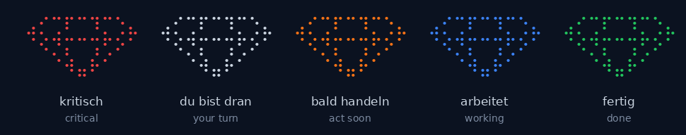
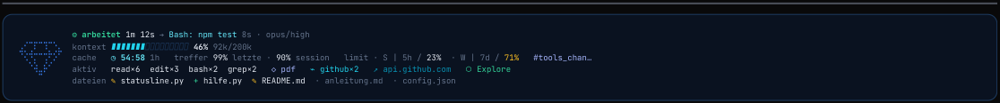
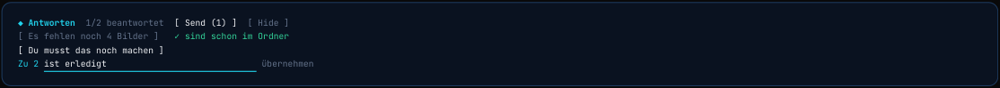
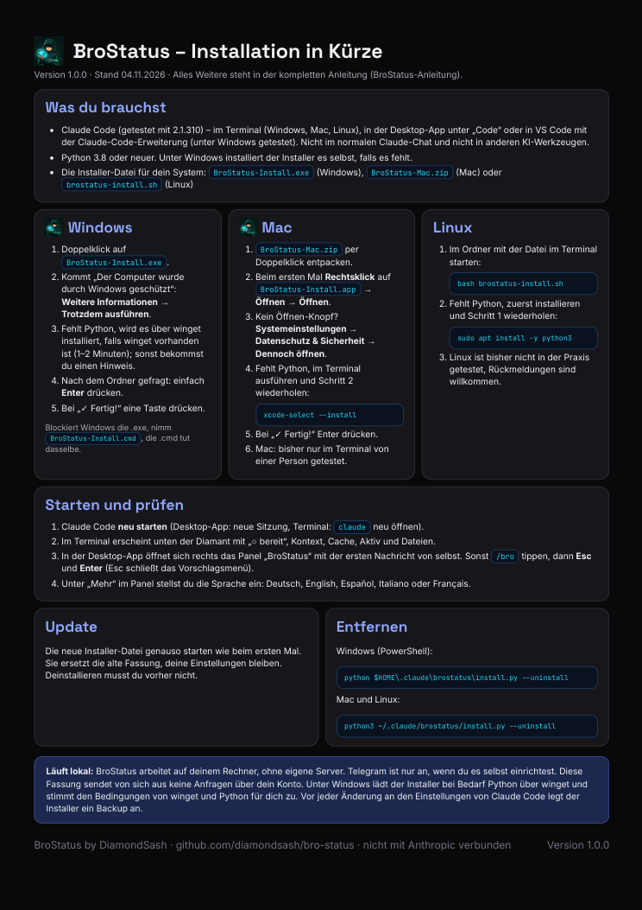
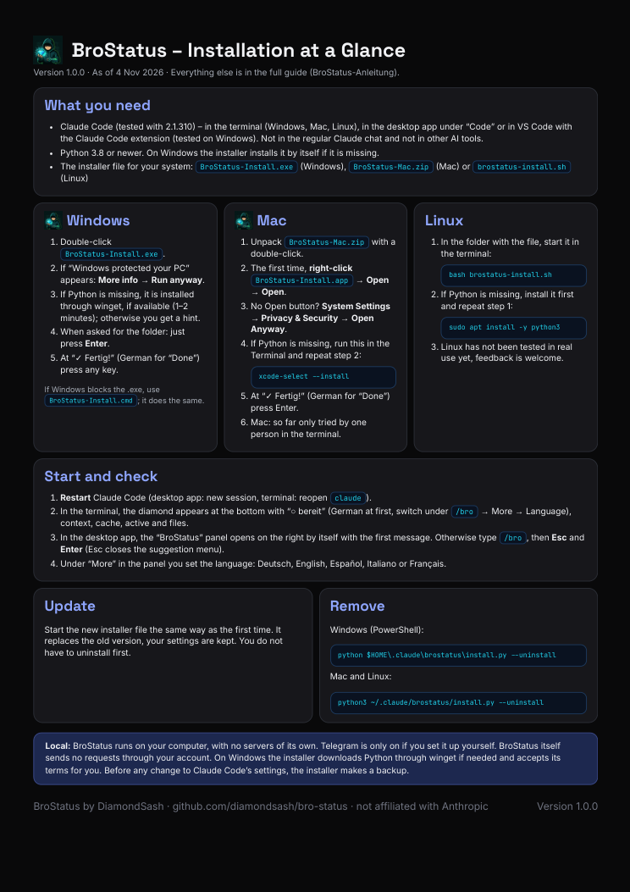

# BroStatus

BroStatus ist eine Mod für Claude Code, also eine Erweiterung, die sich in Claude Code einklinkt. Ein Diamant zeigt dir mit einer Farbe, ob Claude arbeitet, auf dich wartet oder fertig ist. Daneben stehen Kontext, Limits, Prompt-Cache, Werkzeuge und Dateien. Dazu kommen Antwort-Knöpfe, Töne und ein Panel (`/bro`). *(Der Prompt-Cache ist der schon verarbeitete Anfang deines Gesprächs, den Anthropic kurz zwischenspeichert. Bei längeren Pausen verfällt er und wird neu berechnet.)*

BroStatus läuft lokal und kostenlos auf deinem Rechner (Ausnahmen stehen unter „Datenschutz“). Lizenz: MIT mit Commons Clause, nicht Open Source im Sinne der OSI. **English:** [README.en.md](README.en.md)

> **Zu dieser Fassung:** BroStatus sendet hier nichts von selbst über dein Claude-Konto. Cache warmhalten, Auto-Compact, Feierabend und Modellwechsel sind in dieser Fassung nicht enthalten, weil sie automatisch Anfragen über das Konto senden und noch nicht geklärt ist, ob das zu den Nutzungsbedingungen von Anthropic für Abos passt. Ich habe dort nachgefragt (siehe „Geplant“). Nutzung auf eigene Gefahr, ohne Gewähr.

| Farbe | Bedeutung |
| --- | --- |
| rot | kritisch (Abbruch, Kontext ab 85 %, Cache läuft gleich ab) |
| grau/silber | du bist dran, Claude wartet auf dich |
| orange | bald handeln (Kontext ab 50 %, Cache läuft bald ab) |
| blau | Claude arbeitet (auch „arbeitet im Hintergrund“, solange noch etwas läuft) |
| grün | fertig, alles okay |

## Wo es läuft

Nur in **Claude Code**:
- im Terminal (`claude`) unter Windows, Mac und Linux (Teststand siehe „Getestet“)
- in der Claude-Desktop-App im Bereich „Code“
- in Editoren wie VS Code mit der Claude-Code-Erweiterung (unter Windows am 29.10.2026 getestet: Panel, Status und Währung)

Im normalen Claude-Chat und in anderen KI-Werkzeugen (zum Beispiel Cursor, Codex, Gemini) läuft es nicht.

**Version:** Getestet mit Claude Code 2.1.310. Eine Mindestversion habe ich nicht ermittelt, ältere Versionen habe ich nicht geprüft. Die Mod nutzt die Mod-Schnittstelle von Claude Code, und die kann sich ändern. Statusline und Hook sind von der Mod unabhängig und laufen auch ohne sie. Wenn nach einem Update etwas nicht mehr geht, melde es bitte als Issue mit deiner Claude-Code-Version (`claude --version`).

Du brauchst eine Claude-Code-Version mit Mod-Unterstützung und Python 3.8 oder neuer (unter Windows installiert der Installer Python selbst, falls es fehlt).

## Installieren

Lade die Datei für dein System im Ordner [`Installer`](Installer) herunter:

| System | Datei |
| --- | --- |
| Windows | `Installer/Windows/BroStatus-Install.exe` (alternativ: `.cmd`), doppelklicken |
| Mac | `Installer/Mac/BroStatus-Mac.zip` entpacken, `BroStatus-Install.app` öffnen (unsigniert, macOS warnt, siehe unten) |
| Linux (**ungetestet**, der Praxistest wurde abgebrochen) | `Installer/Linux/brostatus-install.sh`, dann `bash brostatus-install.sh` |

Danach Claude Code neu starten (Desktop-App: neue Sitzung). Das Panel öffnest du mit `/bro`; schlägt das Menü dort etwas anderes vor (zum Beispiel einen Skill), drücke erst Esc und dann Enter. Die Installer sind nicht signiert, dein System kann deshalb warnen. Unter macOS hängt der Weg, die App trotzdem zu öffnen, von der Version ab: Rechtsklick → Öffnen, oder Systemeinstellungen → Datenschutz & Sicherheit → „Dennoch öffnen“.

**Prüfsummen:** `Installer/SHA256SUMS.txt` listet die SHA-256-Summen der Installer. Vergleichen kannst du sie unter Windows mit `Get-FileHash <Datei> -Algorithm SHA256`, unter Mac und Linux mit `shasum -a 256 <Datei>`. Die Summen liegen im selben Repo: Sie helfen gegen defekte Downloads, nicht gegen ein verändertes Repo. Wer keine fertige Datei ausführen möchte, nimmt `python install.py` aus dem Ordner `brostatus`, der Quelltext liegt im Repo.

**Was der Installer ändert:** Er ändert in deiner `settings.json` die Einträge `statusLine`, `hooks` (für die Ereignisse von BroStatus) und `env.CLAUDE_CODE_PLUGIN_DIRS`. Eine schon vorhandene Statusline wird ersetzt, sie steht im Backup. Außerdem kopiert er die Dateien standardmäßig nach `~/.claude/brostatus` und versieht den Ordner mit einem Symbol. Das Windows-Skript startet PowerShell mit `-ExecutionPolicy Bypass`, nur für diesen einen Lauf, damit es ohne Änderung deiner Systemeinstellungen läuft. Es entpackt nach `%TEMP%\brostatus-setup`. Im Panel, in der Statusline und im Fenstertitel stehen außerdem die ersten Zeichen des Befehls, den Claude gerade ausführt; teilst du deinen Bildschirm, können sie sichtbar werden.

**Backup und Entfernen:** Vor jeder Änderung kopiert der Installer deine Claude-Code-Einstellungen als `settings.json.bak-<Datum>` neben die `settings.json` im Claude-Ordner. Zum Entfernen gibt es je System einen eigenen Befehl, auch dabei wird wieder ein Backup angelegt:

| System | Befehl |
| --- | --- |
| Mac und Linux (Terminal) | `python3 ~/.claude/brostatus/install.py --uninstall` |
| Windows (PowerShell) | `python $HOME\.claude\brostatus\install.py --uninstall` |

Findet PowerShell `python` nicht, versuche `py`; bei einem eigenen Zielordner nimmst du den Pfad dort. Beim Entfernen bleibt der Ordner `brostatus` liegen, mit deiner `config.json` (dort steht, falls eingerichtet, dein Telegram-Token). Lösche ihn von Hand, wenn du ihn nicht mehr brauchst. Im Unterordner `state/` liegen lokale Zustandsdaten: vollständige Dateipfade, die ersten Zeichen von Befehlen, Suchbegriffen und Aufgabenbeschreibungen, Hostnamen aus Aufrufen, die Namen verwendeter Skills, MCP-Server und Hilfs-Agenten (mit Zähler) und die letzte Warte-Meldung. Steht in einer Befehlszeile ein Geheimnis, kann ein Stück davon dort und im Fenstertitel landen (den Fenstertitel schaltest du mit `"window_title": false` in der `config.json` ab). Solange BroStatus installiert ist, löscht es beim Start einer Sitzung die Dateien in `state/`, die älter als 7 Tage sind.

## So sieht es aus

Das Panel `/bro` zeigt oben den Status wie die Statusline, darunter drei Kreise (Restzeit des Caches, Trefferquote der letzten Anfrage, Trefferquote der Sitzung) und Schalter für Töne. Mit dem Knopf `◆ ▸` klappst du es ein, sodass nur Status und Kreise bleiben. Unter „Mehr“ stehen Töne (mit Lautstärke), Währung, Sprache und zu jedem Punkt eine Erklärung.

## Beispiele

**Cache:** Du arbeitest an etwas, wirst abgelenkt und vergisst den Chat. Der Cache, der Zwischenspeicher für den schon gelesenen Teil des Gesprächs, läuft nach einer Pause ab. BroStatus zeigt dir die Restzeit und den Zustand (warm oder kalt), sodass du siehst, ob die nächste Nachricht günstig wird oder Claude alles neu einlesen muss. Schickst du rechtzeitig selbst eine Nachricht, bleibt er warm. Ist er kalt, geht dein Gespräch nicht verloren, die nächste Nachricht kostet nur mehr. Mit Abo zählt das aufs Kontingent statt aufs Geld.

**Compact:** Du arbeitest konzentriert durch und behältst den Kontext nicht im Blick. Je voller er wird, desto mehr lassen Genauigkeit und Erinnerung nach (oft „Context Rot“ genannt). Der Kontext-Balken zeigt dir den Füllstand und wird rechtzeitig orange und rot. So kannst du den Stand selbst sichern und den Verlauf mit `/compact` zusammenfassen, bevor Claude Code das irgendwann von selbst tut. Was in deinen Dateien steht, bleibt erhalten. Was nur im Chat stand, steckt danach nur noch in der kürzeren Zusammenfassung.

**Töne:** Du machst etwas anderes, während Claude arbeitet. Fragt Claude nach einer Freigabe oder zeigt eine Auswahl, spielt BroStatus in der Desktop-App einen Warnton, und du kannst hingehen und reagieren. Ist Claude nach längerer Arbeit fertig, kommt ein leiser Ton. Beides stellst du unter „Mehr“ ein oder schaltest es aus. Im Terminal piept stattdessen die Terminal-Glocke.

**Zahlen mit ≈:** In der Zeile „kosten“ bedeutet ≈ „geschätzt, kein genauer Wert“. Der API-Wert kommt von Claude Code (lokal aus den Token zum Listenpreis gerechnet; mit Abo zahlst du ihn nicht). Bei der Zeile „nächste Nachricht ≈ … Token“ rechnet BroStatus mit dem Cache-Lesefaktor des Modells, das du gerade nutzt (laut Anthropics Preisliste, Stand 29.10.2026: 0,05 bei Opus 5.5 und Sonnet 5.5, 0,025 bei Fable 5.1 und Mythos 5.1, sonst 0,1). Kennt BroStatus das Modell nicht, nimmt es 0,1; bei neuen Modellen kann der Faktor abweichen.

## Was BroStatus kann

- **Statusline** unten in Claude Code: Status, Kontext-Ampel (Balken ab 50 % gelb, ab 70 % orange, ab 85 % rot), Limits (`· S | 5h / 23%  · W | 7d / 71%`: S = Sitzung mit 5 Stunden, W = Woche mit 7 Tagen, der Prozentwert ist der verbrauchte Anteil), Prompt-Cache mit Restzeit und Trefferquote, genutzte Werkzeuge, Skills, MCP-Server und geänderte Dateien.

  
- **Panel `/bro`** (in der Desktop-App öffnet es sich mit deiner ersten Nachricht von selbst): Status, die drei Kreise (Cache-Restzeit, Trefferquote der letzten Anfrage und der Sitzung), Limits, Kosten und Schalter für Töne, Währung und Sprache. Das Panel selbst sendet nichts und verbraucht keine Token.
- **Nicht enthalten (noch):** Cache warmhalten, Auto-Compact, Feierabend und Modellwechsel. Sie senden automatisch Anfragen über dein Konto; siehe „Geplant“.
- **Währung:** Unter „Mehr“ wählst du Dollar, Euro, Pfund oder Franken. Der API-Wert in der Zeile „kosten“ wird mit einem eingebauten Kurs umgerechnet (EZB-Referenzkurs vom 28.10.2026, das Datum steht im Panel; eigener Kurs in `config.json`). BroStatus lädt keine Kurse aus dem Netz; mit jeder neuen Version wird der Kurs aktualisiert. Es bleibt eine Schätzung (≈), kein Rechnungsbetrag.
- **Töne in der Desktop-App:** ein Warnton, wenn Claude wirklich auf dich wartet, und ein leiser Ton, wenn Claude fertig ist. Auf Wunsch wiederholt sich der Ton alle 2 oder 5 Minuten, höchstens 3-mal, und hört auf, sobald du reagierst. Die Lautstärke stellst du unter „Mehr“ in vier Stufen ein (unter Windows). Eigene Töne kannst du dazulegen (siehe „Eigene Töne und Sound-Packs“ weiter unten).
- **Dich holen:** BroStatus zeigt Claudes Zustand im Fenstertitel, schickt eine Meldung im Terminal (je nach Terminal; in der Desktop-App kommt nur der Ton) und, wenn du es einrichtest, eine Nachricht per Telegram aufs Handy (Einzelheiten unter „Datenschutz“ und in der Anleitung).
- **Antwort-Knöpfe:** Fragt Claude mehrere Punkte ab, bekommst du über dem Eingabefeld Knöpfe statt Tipparbeit. Punkt anklicken, Antwort tippen, „Send“ schickt alles gesammelt. Bei einer Ja/Nein-Frage gibt es die Knöpfe „Ja“ und „Nein“, bei genannten Wegen WEG 1 und WEG 2, unter einem Bericht gibt es die Knöpfe NÄCHSTE AUFGABE, SPEICHERN und WAS IST OFFEN? Diese drei Knöpfe senden sofort bei einem Klick: „Zeig mir die startbaren Aufgaben.“, „Speichere jetzt: prüfen, committen, Pull Request.“ und „Was ist bei dieser Aufgabe noch offen?“ und sind für Projekte mit Aufgabenliste und Git gedacht.

  
- **Fünf Sprachen:** Deutsch, English, Español, Italiano, Français.

## Geplant

- **Die ausgelassenen Funktionen** (Cache warmhalten, Auto-Compact, Feierabend, Modellwechsel): Sie kommen in einer späteren Fassung, sobald geklärt ist, ob sie zu den Nutzungsbedingungen von Anthropic für Abos passen. Dazu habe ich eine Frage an Anthropic gestellt ([anthropics/claude-code#106161](https://github.com/anthropics/claude-code/issues/106161)); eine Antwort steht aus. Das ist kein Versprechen. Zu dieser Fassung kommt später ein Modellwechsel mit Auswahl-Knöpfen dazu; ob und wie das in der Desktop-App geht, ist noch offen.

## Sicherheit und Vertrauen

BroStatus ändert Einstellungen auf deinem Rechner und führt dort Code aus. Du musst mir das nicht glauben, du kannst es prüfen:

- **Quelltext lesen:** Alle Skripte (`brostatus/`) sind Klartext. Wer keine fertige Datei ausführen möchte, nimmt `python install.py` aus dem Ordner `brostatus`.
- **Prüfsummen:** `Installer/SHA256SUMS.txt` (Vergleich siehe „Installieren“).
- **Virenscanner:** Ich habe die vier Installer (Windows `.exe` und `.cmd`, Mac `.zip`, Linux `.sh`) am 04.11.2026 per Befehlszeile mit Microsoft Defender geprüft. Die Prüfsummen dieser Dateien stehen in `Installer/SHA256SUMS.txt`; Defender hat nichts gemeldet. Das ist ein einzelner Scanner und kein Beweis. Die Installer sind unsigniert, manche Scanner reagieren auf unsignierte Programme auch ohne Grund.
- **Prüfung mit einem KI-Werkzeug:** Vor dem Veröffentlichen habe ich den Quelltext und die Inhalte der Installer mit einem KI-Werkzeug auf Sicherheit und Datenschutz durchsehen lassen (die Mod gezielt per Suche, nicht Zeile für Zeile) und die Befunde behoben. Das ist eine Hilfe, kein unabhängiges Gutachten.
- **Unabhängige Prüfung gesucht:** Kennst du dich mit IT-Sicherheit aus? Dann schau gern in den Code oder die Installer, zum Beispiel mit eigenen Virenscannern, in einer Sandbox oder durch Lesen des Quelltexts. Eine Bestätigung kannst du als normales Issue melden, einen Sicherheitsfund bitte privat (siehe [SECURITY.md](SECURITY.md)); auf Wunsch nenne ich dich im [CHANGELOG](CHANGELOG.md). Bisher hat das noch niemand unabhängig bestätigt. Sobald es jemand tut, steht es hier.

## Datenschutz

BroStatus sendet keine Daten an mich. Was Claude Code ohnehin an Anthropic überträgt, bleibt, wie es ist. Darüber hinaus geht nur Folgendes nach außen:
- **Telegram (nur wenn du es einrichtest):** Fertig- und Warte-Meldungen an deinen eigenen Bot (sie laufen über die Server von Telegram), also der Projektname und die Meldung, die Claude Code selbst anzeigt (bis 80 Zeichen). Die ersten 400 Zeichen von Claudes letzter Antwort und der Rechnername kommen nur dazu, wenn du sie in der Konfiguration selbst einschaltest (Standard: aus). Bot-Token und Chat-ID stehen in der Konfigurationsdatei von BroStatus auf deinem Rechner, im Klartext. Unter macOS und Linux ist die Datei nur für dich lesbar, unter Windows setzt der Installer keine eigenen Dateirechte. Nutzt du BroStatus beruflich, gehen mit Telegram möglicherweise vertrauliche Daten an einen Dienst außerhalb der EU; das entscheidest du.
- **Anfragen an Claude:** Diese Fassung erzeugt keine eigenen Anfragen über dein Claude-Konto. Die Knöpfe unter Berichten (NÄCHSTE AUFGABE, SPEICHERN, WAS IST OFFEN?) und die Antwort-Knöpfe schicken erst bei deinem Klick eine Nachricht in deine Sitzung, so als hättest du sie getippt; das zählt auf deine Token und Limits.
- **Python-Download:** Der Windows-Installer lädt bei Bedarf Python über `winget` herunter. Dabei stimmt er den Lizenz- und Quellbedingungen von winget und Python für dich zu.

Die Statusline und das Panel selbst verbrauchen keine Token.

## Eigene Töne und Sound-Packs (Windows)

Du kannst die Töne von BroStatus selbst gestalten:

1. Lege WAV-Dateien in den Ordner `%USERPROFILE%\.claude\brostatus\toene`.
2. Der Name sagt, wofür der Ton ist: `warten-<Name>.wav` ist der Warnton, wenn Claude auf dich wartet, `fertig-<Name>.wav` der leise Ton, wenn Claude fertig ist. Beispiel: `warten-Glocke.wav` und `fertig-Glocke.wav`.
3. Starte eine neue Sitzung. Unter „Mehr“ → Töne findest du deine Töne hinter den eingebauten, beim ersten Mal sind sie schon ausgewählt. Ein Update löscht sie nicht.

**Sound-Packs:** Ein Pack ist einfach ein ZIP mit solchen Dateien, das andere in denselben Ordner entpacken. Hast du ein Soundset gebaut oder die Töne verbessert? Dann stell es als Issue vor (Vorlage „Soundset vorstellen“) mit einem Link zu deinem Pack. Gib an, woher die Töne kommen und unter welcher Lizenz sie stehen. Passende Packs verlinke ich hier in der README, wenn die Lizenz klar ist, und nenne dich, wenn du es möchtest. Das Pack selbst liegt bei dir, nicht in diesem Repo.

Bitte teile nur Töne, die du selbst gemacht hast oder die frei verwendet werden dürfen. Töne aus Filmen, Serien oder Spielen darfst du meist nicht weitergeben (keine Rechtsberatung). Grenzen: nur Windows, nur WAV-Dateien. Die mitgelieferten Töne sind selbst berechnet, nicht aus fremden Quellen, und stehen unter derselben Lizenz wie der Code.

## Was liegt wo

- `Installer/`: die fertigen Installer und die Prüfsummen
- `Anleitung/`: die Anleitungen als PDF in fünf Sprachen
- `brostatus/`: der Quelltext (Statusline, Hook, Installer-Skript); darin ist `bro-status/` die Mod
- `brostatus/README.md`: die technische Beschreibung für alle, die tiefer einsteigen wollen
- `bilder/`: die Bilder dieser Seite

## Anleitungen

Im Ordner [`Anleitung`](Anleitung), je Sprache ein Unterordner: [`DE`](Anleitung/DE) Deutsch, [`EN`](Anleitung/EN) English, [`ES`](Anleitung/ES) Español, [`IT`](Anleitung/IT) Italiano, [`FR`](Anleitung/FR) Français. Darin jeweils:
- `BroStatus-Installation-XX.pdf`: die Installation auf einer Seite
- `BroStatus-Anleitung-XX.pdf`: alles ausführlich mit Bildern

Die Installation auf einer Seite, zum Öffnen aufs Bild klicken:

| Deutsch | English |
| --- | --- |
|  |  |

## Getestet

Die Angaben „von Hand“ und „auf anderen Rechnern“ sind meine eigenen Beobachtungen, ein Testprotokoll gibt es dazu nicht.

- **Automatisch, bei mir bei jeder Änderung:** rund 90 Tests für die Mod (`claude plugin test`, die Testdatei liegt im Repo). Dazu prüfe ich lokal die Statusline in allen Zuständen, den Installer und die Sicherheitsfunktionen; diese Prüfungen gehören nicht zu diesem Repo. Auf GitHub läuft keine automatische Prüfung.
- **Diese Fassung von Hand:** Die Fassung ohne die automatischen Funktionen habe ich in der echten Oberfläche noch nicht angesehen; sie teilt sich den Code mit der vollen Fassung, in der ich vieles von Hand im echten Einsatz gesehen habe (Windows 10, Claude-Desktop-App): „wartet auf dich“ mit Warnton, „arbeitet im Hintergrund“, Töne samt Wiederholung und eigenen Tönen.
- **Nicht einzeln geprüft:** Telegram und Antwort-Knöpfe gehören zu keiner meiner Testreihen und auch nicht zu den rund 90 Tests; sie liefen im Einsatz mit. Die Währung habe ich nur in VS Code von Hand angesehen.
- **Terminal** (PowerShell unter Windows): Es war bei mir im Einsatz, ohne eigene Testreihe.
 Der Installer lief auf einem anderen Windows-PC, und eine andere Person hat BroStatus auf einem Mac im Terminal ausprobiert (macOS-Version nicht festgehalten). Das war vor den letzten Änderungen.
- **VS Code** (Claude-Code-Erweiterung, Windows): Am 29.10.2026 getestet. Das Panel mit Status, Cache-Kreisen, Schaltern und Währung läuft, das Modell wurde erkannt. Töne und weitere Funktionen habe ich dort nicht einzeln geprüft.
- **Nicht getestet:** Linux (der Installer liegt bei, der Test wurde abgebrochen) und die Mac-Desktop-App.

## Wie BroStatus entstanden ist

Alles begann damit, dass mein Prompt-Cache kalt wurde: Claude musste den gesamten Kontext neu laden, und mein Limit war schneller aufgebraucht als gedacht. Am Samstagmorgen, dem 24.10.2026, habe ich angefangen, mir gemeinsam mit Claude Code eine Mod dafür zu bauen, und noch am selben Tag war sie bei mir im Einsatz. Ab Sonntag hat eine weitere Person mit ausprobiert, und den Rest der Woche wuchsen die Funktionen und Tests. Das Warmhalten, das aus dem kalten Cache entstand, ist in dieser Fassung noch nicht enthalten (siehe „Geplant“). Seitdem sind Töne, Limits, Kosten und Antwort-Knöpfe dazugekommen. Da BroStatus noch ganz frisch ist, freue ich mich über Rückmeldungen und unabhängige Prüfungen als Issue.

## Feedback

BroStatus ist eine kostenlose Mod, und ich baue es gern weiter aus. Schreib mir am liebsten als [Issue](https://github.com/diamondsash/bro-status/issues): Wünsche, Verbesserungsvorschläge oder Fehler. Bei Fehlern am besten mit **Screenshot**, deinem System (Windows, Mac, Linux), dem Ort, an dem du Claude Code nutzt (Terminal, Desktop-App, VS Code), und dem, was du gerade gemacht hast. Auf Screenshots der Statusline stehen oft Projektnamen, Dateipfade und Rechnernamen; mach sie bitte unkenntlich, wenn sie privat sind.

Besonders hilfreich sind Rückmeldungen unter Linux, aus der Mac-Desktop-App und aus VS Code auf Mac und Linux.

Pull Requests erwarte ich derzeit nicht. Wer trotzdem einen schickt, stellt den Beitrag unter dieselbe Lizenz wie den Code (MIT mit Commons Clause).

**Updates:** Neue Versionen erscheinen unter [Releases](https://github.com/diamondsash/bro-status/releases), was sich geändert hat, steht in der [CHANGELOG.md](CHANGELOG.md). Wenn du benachrichtigt werden möchtest, klicke oben auf **Watch** → **Custom** → **Releases**. Einen festen Rhythmus gibt es nicht: Ein Update kommt, wenn es etwas zu verbessern gibt. Führt dein Hinweis zu einer Änderung oder Fehlerbehebung, nenne ich dich gern im Update, wenn du es im Issue erlaubt hast (Kästchen in der Vorlage). Und wenn dir BroStatus hilft, freue ich mich über einen Stern ⭐ oben rechts.

## Hinweis

BroStatus ist ein privates, kostenloses Projekt von [DiamondSash](https://github.com/diamondsash) und nicht mit Anthropic verbunden, von Anthropic weder unterstützt noch geprüft. Claude und Claude Code sind Marken von Anthropic.

## Lizenz

Der Code ist öffentlich einsehbar, aber nicht Open Source im Sinne der OSI. Er steht unter der MIT-Lizenz mit einem **Commons-Clause**-Zusatz, der den Verkauf untersagt, siehe [LICENSE](LICENSE). Das heißt:

- **Erlaubt:** BroStatus kostenlos nutzen, privat und beruflich, den Code ansehen, ändern und weitergeben, solange der Hinweis „Copyright (c) 2026 DiamondSash“ und die komplette Lizenz (MIT mit Commons Clause) dabeibleiben.
- **Nicht erlaubt:** BroStatus zu **verkaufen** oder etwas gegen Bezahlung anzubieten, dessen Wert ganz oder wesentlich aus BroStatus kommt (zum Beispiel eine kostenpflichtige Fassung, ein bezahlter Dienst oder bezahlter Support dafür).

Nutzung auf eigene Gefahr, ohne Gewähr.

**Name und Figur:** Den Namen „BroStatus“ und die Figur „Bro“ (das Profilbild des Autors; die Bilddateien `icon*.png` und `brostatus.ico`) darf jeder kostenlos nutzen, um BroStatus zu beschreiben, zu bewerben und zu verbreiten, auch bei veränderten Fassungen. Herabwürdigend oder täuschend dürfen sie nicht verwendet werden. Eine veränderte Fassung braucht einen eigenen Namen ohne „BroStatus“ (erlaubt ist „basiert auf BroStatus von DiamondSash“ mit Link auf dieses Repo). Sie darf sich nicht als das Original ausgeben und nicht als von DiamondSash gemacht, gebilligt oder unterstützt, und sie muss als veränderte Fassung erkennbar sein. Als verändert gilt eine Fassung, wenn Code, Texte oder Bilder geändert sind; eigene Konfiguration und eigene Töne zählen nicht. Wer einen Zusatz für BroStatus macht, etwa ein Sound-Pack, darf diesen Zusatz „für BroStatus“ nennen, zum Beispiel „Retro-Töne für BroStatus“. Offiziell ist nur die unveränderte Fassung aus diesem Repo. Der Diamant ist Teil der Software. Maßgeblich ist der englische Text in [LICENSE](LICENSE), [BRANDING.md](BRANDING.md) erklärt es zusätzlich.

---
